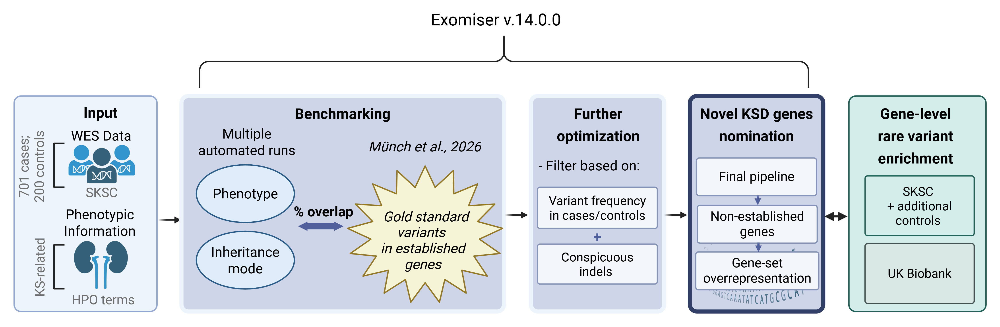

# Optimizing Exomiser to prioritize candidate genes underlying monogenic forms of common disease

Scripts and analysis code accompanying the manuscript **"Optimizing Exomiser to prioritize candidate genes underlying monogenic forms of common disease"** (Jana Petrovska, Isabel Rubio-Aliaga, Dorian T'Sjoen, Judith Van Wynsberghe, Olivier Vanakker, Johannes Münch, Elena M. Cabello, Olivier Bonny, Carsten A. Wagner, Ruxandra Bachmann-Gagescu; manuscript in preparation, preprint coming soon on medRxiv).

[](LICENSE)

## Overview

This repository contains the code used to benchmark and optimize an automated variant/gene prioritization pipeline (Exomiser v14.0.0) for the diagnosis of monogenic forms of a common disease, kidney stone disease (KSD), and to nominate novel candidate genes. The workflow is summarized in the figure below:



*Created in BioRender. Petrovska, J. (2026) https://BioRender.com/c6mzu2h*

- **Input** — whole-exome sequencing (WES) data of the Swiss Kidney Stone Cohort (SKSC; cases and controls) and phenotypic information (kidney stone–related HPO terms), run through Exomiser with different settings.
- **Benchmarking** — Exomiser runs with different phenotype and inheritance-mode settings are compared against a gold-standard set of manually curated variants in established KSD genes (proportion of variants prioritized within the top *N* ranks).
- **Further optimization** — removal of PAPSS2 and FAM20C (genes with conspicuous recurrent indels) with re-ranking, Exomiser score cutoffs, and case/control frequency filters.
- **Novel gene nomination** — the optimized pipeline is applied to non-established genes; top-ranked candidates are tested for gene-set overrepresentation (GO, KEGG).
- **Gene-level rare variant enrichment** — candidate genes are looked up in gene-level burden tests (MAGMA on SKSC cases vs in-house controls, SKSC cases vs external controls) and validated against UK Biobank kidney stone PheWAS results.

Results can be explored interactively in a genomic browser: **https://sksc-variant-and-biochemistry.shinyapps.io/exomiser-candidates/** (the R Shiny app in `viewer_app/`; see [Interactive results viewer](#interactive-results-viewer)).

## Repository structure

```
.
├── 00_setup.R                 # shared settings, paths and helper functions (sourced by every step)
├── 01_benchmarking_combine_exomiser_results_multirun.Rmd
├── 02_read_filter_save.Rmd
├── 03_benchmarking_figure_2A.Rmd
├── 04_make_figure_2B_violin.Rmd
├── 05_make_figure_2C_acmg.Rmd
├── 06_additional_filtering_save.Rmd
├── 07_go_kegg_enrichment.Rmd
├── 08_top_ranked_per_participant.Rmd
├── 09_gene_level_tests_overlap.Rmd
├── 10_combine_figures.Rmd
├── 11_magma_manhattan_plots.Rmd
├── run_all.R                  # renders all steps in order
├── pipeline_configs/          # Exomiser analysis configs (YAML), HPO terms and run scripts
│                              #   (see pipeline_configs/README.md)
├── input/                     # (not tracked) external inputs: gene-level test results, candidate gene list
├── output/                    # (not tracked) everything the pipeline writes
│   ├── results/               #   tables (.tsv/.txt/.xlsx/.docx) and enrichment objects (.RData)
│   ├── counts_per_rank/       #   benchmarking counts (Figure 2A)
│   ├── figures/               #   figures; images/ holds the ggplot objects (.RData)
│   └── reports/               #   one HTML report per step
├── viewer_app/                # R Shiny app for browsing candidate genes and variants
├── assets/                    # README images (workflow diagram, etc.)
├── LICENSE
├── CITATION.cff
└── README.md
```

## Pipeline steps

Each step is an R Markdown file that renders to an HTML report in `output/reports/`. Steps must be run in this order (`run_all.R` does this).

| Step | Script | What it does | Main outputs |
|---|---|---|---|
| 1 | `01_benchmarking_combine_exomiser_results_multirun.Rmd` | For each benchmarking run, counts how many gold-standard gene/participant pairs are found within the top 1–30 Exomiser ranks | `output/counts_per_rank/` |
| 2 | `02_read_filter_save.Rmd` | Reads the ESTABLISHED (gold-standard pairs) and NON-ESTABLISHED (all non-KSD genes) runs, collapses to one rank per gene, removes PAPSS2/FAM20C and re-ranks | `All_vars_ESTABLISHED_*.tsv`, `All_vars_NONESTABLISHED_*.tsv` |
| 3 | `03_benchmarking_figure_2A.Rmd` | Proportion of gold-standard variants prioritized per rank, per run | Figure 2A |
| 4 | `04_make_figure_2B_violin.Rmd` | Phenotype and variant score distributions, ESTABLISHED vs NON-ESTABLISHED | Figure 2B |
| 5 | `05_make_figure_2C_acmg.Rmd` | Automated ACMG classification, ESTABLISHED vs NON-ESTABLISHED | Figure 2C |
| 6 | `06_additional_filtering_save.Rmd` | Score filters, top rank, case/control frequency and burden (Fisher) filters → candidate NON-ESTABLISHED genes | candidate gene and variant tables |
| 7 | `07_go_kegg_enrichment.Rmd` | GO (biological process) and KEGG overrepresentation of the candidate genes; term clustering (simplifyEnrichment, rrvgo) | GO/KEGG plots, enrichment objects |
| 8 | `08_top_ranked_per_participant.Rmd` | Top-ranked genes/variants per participant of the benchmarking run, down to the established gene | Excel table |
| 9 | `09_gene_level_tests_overlap.Rmd` | Candidate genes in MAGMA, external-control and UK Biobank gene-level tests; SKSC/UKBB overlap | result tables, Figure 3B |
| 10 | `10_combine_figures.Rmd` | Assembles the manuscript figures | Figures 2 and 3 |
| 11 | `11_magma_manhattan_plots.Rmd` | Manhattan plots of the MAGMA gene-level analysis (all genes; candidate genes) | Manhattan plots |

## Requirements

- **R** ≥ 4.6 (developed with R 4.6.1) and **pandoc** (bundled with RStudio) for rendering the R Markdown reports.
- **R packages**
  - CRAN: `tidyverse`, `rmarkdown`, `knitr`, `openxlsx`, `gt`, `ggpubr`, `shadowtext`, `smplot2`, `ggVennDiagram`
  - Bioconductor: `clusterProfiler`, `enrichplot`, `org.Hs.eg.db`, `simplifyEnrichment`, `rrvgo`, `ggmanh`
  - Viewer app: `shiny`, `bslib`, `DT`, `trackViewer`, `GenomicRanges`, `biomaRt` (only for `prepare_transcripts.R`), `rsconnect` (only for deployment)
- **Exomiser** v14.0.0 with data release 2406 (GRCh37/hg19 and phenotype data), installed and configured separately — see `pipeline_configs/` and the [Exomiser documentation](https://exomiser.readthedocs.io/).
- Internet access for step 7 (KEGG is queried online) and for `viewer_app/prepare_transcripts.R` (Ensembl GRCh37).

```r
install.packages(c("tidyverse", "rmarkdown", "knitr", "openxlsx", "gt", "ggpubr",
                   "shadowtext", "smplot2", "ggVennDiagram", "shiny", "bslib", "DT", "BiocManager"))
BiocManager::install(c("clusterProfiler", "enrichplot", "org.Hs.eg.db", "simplifyEnrichment",
                       "rrvgo", "ggmanh", "trackViewer", "GenomicRanges", "biomaRt"))
```

## Input data

### Exomiser runs

Exomiser is run per participant with the analysis files in `pipeline_configs/analysis/` (one per run; settings, HPO terms and run instructions in [`pipeline_configs/README.md`](pipeline_configs/README.md)). The pipeline expects one folder per run, each containing Exomiser's per-participant variant tables:

```
<exomiser_dir>/
├── SKSC_3_MAF1per/                        # benchmarking / ESTABLISHED run
├── SKSC_3_MAF1per_herIncluded/            # benchmarking run
├── SKSC_3_MAF1per_herIncluded_onlyKS/     # benchmarking run
└── SKSC_3_MAF1per_nonHIT/                 # NON-ESTABLISHED run
    └── <VCF_ID>.hard-filtered-exomiser.variants.tsv
```

### Other inputs

Referenced in `00_setup.R`:

- gold-standard (manually curated) KSD variants per participant
- participant ID mapping and study QC filter (`IDs_for_study_filtering.txt`)
- list of established KSD genes (`KS_genes.txt`)

In `input/`:

- `SKSC_and_Controls_WES_filtered_ks_gnomAD_0.02CADD20_GEN_SEX_corrected.genes.out` — MAGMA gene-level results (SKSC cases vs in-house controls)
- `Results_misslof_am0.8_1_lambda1.12_GnomADMAF0.01_MAF0.01_ks.txt` — gene-level results, SKSC cases vs external controls
- `41202_N200_Calculus_of_kidney_*_PheWAS_Portal.csv` — UK Biobank kidney stone PheWAS (AstraZeneca PheWAS Portal)
- `candidate_genes_restr.txt` — curated list of candidate KSD genes

### Configuration

Run settings (Exomiser version, runs, score cutoffs, PAPSS2/FAM20C removal) and all input paths are set at the top of `00_setup.R`. Edit the paths there to point to your copies of the inputs.

## Usage

```bash
Rscript run_all.R
```

`run_all.R` renders all steps in order and works from any working directory. To run a single step (after its inputs exist):

```r
rmarkdown::render("07_go_kegg_enrichment.Rmd", output_dir = "output/reports")
```

When running outside RStudio, R may not find pandoc; point it to RStudio's copy first, e.g.

```bash
export RSTUDIO_PANDOC="C:/Program Files/RStudio/resources/app/bin/quarto/bin/tools"
```

## Interactive results viewer

`viewer_app/` contains an R Shiny app for browsing the candidate genes, available online at https://sksc-variant-and-biochemistry.shinyapps.io/exomiser-candidates/. For a selected gene it shows:

- the gene's transcript/exon structure with the prioritized (rank 1) variants as a lollipop plot (`trackViewer`), one circle per carrier
- a variant table with Exomiser annotations (HGVS, allele frequency, pathogenicity predictions, automated ACMG class)
- per-gene biochemistry figures, if present in `viewer_app/figures/` (not generated by this repository)

The app works offline from two prepared inputs:

| File | Created by | Content |
|---|---|---|
| `transcripts.rds` | `prepare_transcripts.R` | exon structure of each candidate gene (Ensembl GRCh37, fetched once via `biomaRt`) |
| `variants_exomiser_14.0.0.rds` | `prepare_variants.R` | candidate variants per gene, aggregated across carriers |

To rebuild the inputs after re-running the pipeline and launch the app:

```r
setwd("viewer_app")
source("prepare_variants.R")
source("prepare_transcripts.R")   # needs internet access
shiny::runApp()
```

Variant positions are GRCh37/hg19, matching the transcript cache.

## Data availability

The main datasets supporting the conclusions are included in the manuscript (and its additional files), and available from a genomic browser: https://sksc-variant-and-biochemistry.shinyapps.io/exomiser-candidates/. Any additional data will be shared upon request to the corresponding authors, except for per-patient WES data, for data protection reasons. Individual-level data and the per-participant pipeline outputs are therefore not part of this repository (`input/`, `output/`).

The gene-level and variant-level association summary statistics from the UK Biobank sample are freely accessible from the [AstraZeneca PheWAS Portal](https://azphewas.com/).

## Citation

The manuscript is in preparation; the preprint link will be added here once available. Until then, if you use this code, please cite this repository:

> Petrovska J, Rubio-Aliaga I, T'Sjoen D, Van Wynsberghe J, Vanakker O, Münch J, Cabello EM, Bonny O, Wagner CA, Bachmann-Gagescu R. Optimizing Exomiser to prioritize candidate genes underlying monogenic forms of common disease [code repository]. 2026. https://github.com/PetJana/optimizing_exomiser_common_disease

A machine-readable citation is also provided in [`CITATION.cff`](CITATION.cff).

## License

This project is licensed under the MIT License — see [LICENSE](LICENSE) for details.
